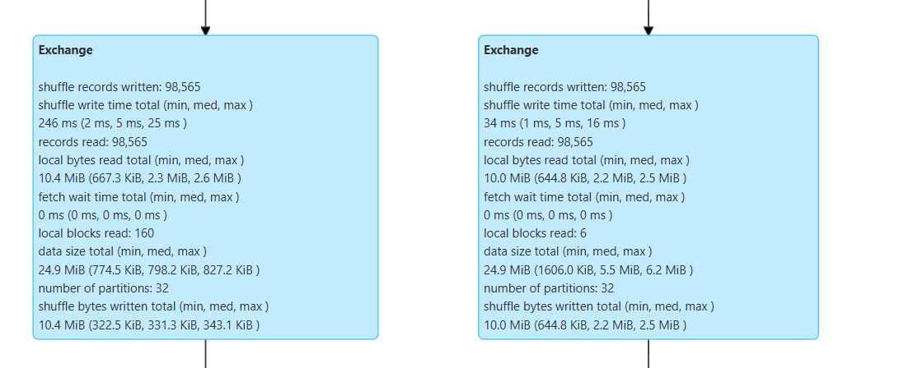

# Análisis del pipeline — Lab 1b

**Curso:** ST1630-2026-2 · **Semana:** S5-S6
**Estudiantes:** Mateo García Carreño — mgarciac10@eafit.edu.co
Juan José Gomez — jjgomezv2@eafit.edu.co
Juan José Vargas — jjvargasl@eafit.edu.co
Luis Moreno Gutierrez

> Copia este archivo a tu carpeta de entrega como `pipeline_analysis.md`
> y complétalo después de correr los 4 scripts (`01_bronze.py` a
> `04_athena_benchmark.py`) y de revisar Spark UI (Parte 3.8 del lab).

## Pregunta 1 — Exchange del pipeline completo

¿Cuántos `Exchange` tiene el pipeline completo (Bronze → Silver →
Gold)? Identifica a qué operación corresponde cada uno y explica en
términos físicos (shuffle write, shuffle read) por qué esa operación es
WIDE.

→ El pipeline tiene 9 Exchange: 7 más los 2 del MERGE. Bronze no tiene ninguno; Silver tiene el dropDuplicates (1) y el max(fecha) de la corrección de fechas (1, SinglePartition); Gold tiene el KPI 1 (1), el KPI 2 con groupBy y Window (2) y el KPI 3 con groupBy y orderBy (2). Todas son WIDE porque en el shuffle write cada tarea map escribe a disco sus filas separadas por el hash de la clave, y en el shuffle read cada tarea reduce trae por red su bloque de todas las map. Los 2 del MERGE salen del join por pedido_id en la query 33.

## Pregunta 2 — Recalcular vs. filtrar `total`

Elegiste recalcular `total` desde `cantidad × precio_unit` en vez de
filtrar las filas con `total` incorrecto. ¿Cuántas filas preservaste
con esta decisión vs. filtrar directamente por `total` inválido?
¿Cuándo NO sería correcto recalcular?

→ Recalcular dejó 98.763 filas de las 100.000 únicas, contra 94.112 si se filtraba por total que no cuadra con cantidad × precio_unit (96.096 si solo se filtraban nulos y ≤ 0), unas 4.651 filas más. Entre ellas hay 793 con un total exactamente 1.000 veces mayor al real, un error sistemático de unidades. No sería correcto recalcular cuando total incluye descuentos, impuestos o envío, ni cuando los factores son los que están mal, como un precio_unit negativo.

## Pregunta 3 — Robustez de la normalización de región

Para la normalización de región usaste `upper(trim())` + `when()` para
aliases. ¿Qué pasaría con una variante nueva que llegue la próxima
semana (`'BOG'`, `'Bgo'`)? ¿Cómo harías el pipeline más robusto sin
tener que reescribirlo cada vez que aparece una variante nueva?

→ 'BOG' o 'Bgo' saldrían como SIN_MAPEO, porque el valor por defecto no es OTRO, y la verificación de 6 valores fallaría en vez de esconderlos. Para no reescribir el pipeline cada vez, sacaría el mapa a una tabla externa (CSV o Delta) que se actualice sin tocar el código, conservaría la región original en otra columna y mandaría los SIN_MAPEO a una tabla de cuarentena con alerta.

## Pregunta 4 — Partición y shuffle files

Ajustaste `spark.sql.shuffle.partitions=32`. Con 101.500 filas y 32
particiones: ¿cuántas filas por partición, en promedio? ¿Qué pasaría
con el valor por defecto de 200 particiones? Calcula el número de
shuffle files que genera el MERGE con 200 particiones vs. 32, en un
clúster de 4 executors.

→ 101.500 / 32 son unas 3.172 filas por partición, contra unas 507 con las 200 por defecto, tareas tan pequeñas que programarlas cuesta más que procesarlas. Con 4 executors, los shuffle files del MERGE son 4 × 32 = 128 contra 4 × 200 = 800. Silver pesa solo unos 2,9 MB en 5 archivos, así que 200 particiones sería sobredimensionar.

## Pregunta 5 — Benchmark Athena

Según `benchmark_resultados.md`: ¿cuál fue el ratio real de bytes
escaneados (CSV vs. Parquet)? ¿Por qué el ratio puede ser distinto del
teórico (~9x del slide de S4)? ¿Qué efecto tuvo el Z-ordering sobre los
bytes escaneados?

→ El ratio real fue de 44,86x (1.549.198 bytes del CSV contra 34.535 de Parquet), muy por encima del ~9x teórico. No es una comparación equivalente: Gold ya está agregada (3.270 filas) frente a 10.000 filas de detalle en el CSV, Parquet lee solo 3 columnas y el CSV se escaneó dos veces por la subconsulta MAX(fecha). El Z-ordering no tuvo efecto, porque OPTIMIZE reescribió 1 archivo de 59.693 bytes en otro único y no hay archivos entre los que saltar.
